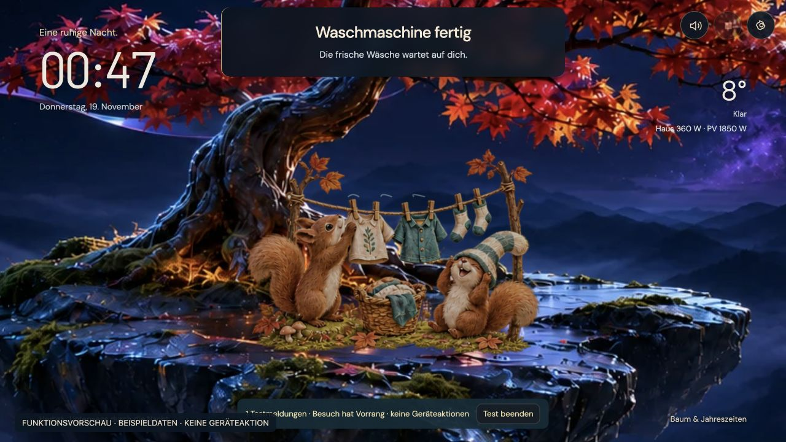
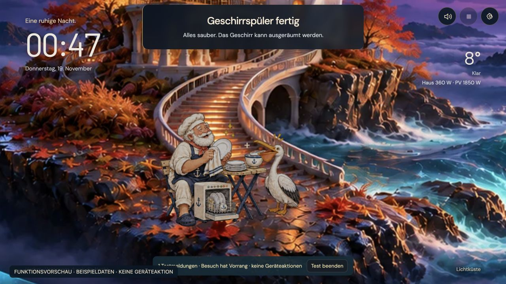
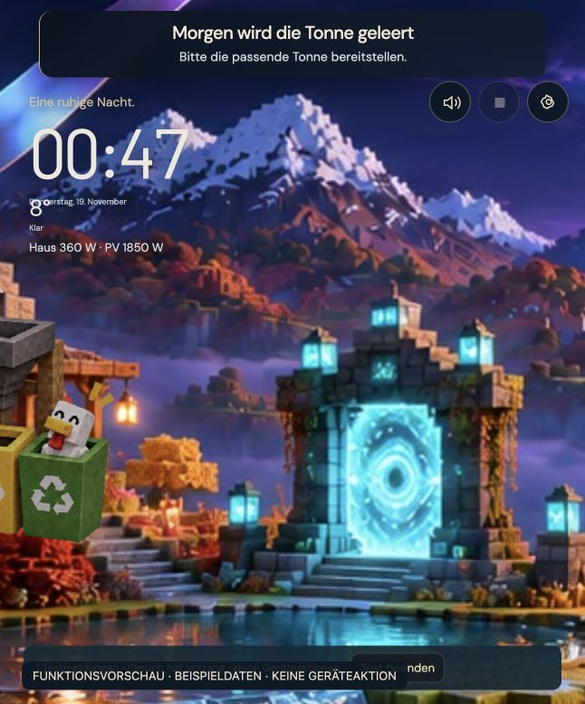
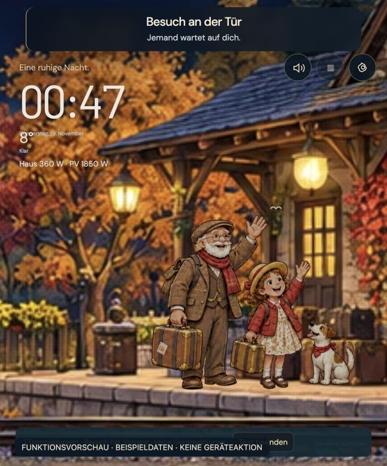

# OLED Bildschirmschoner für Home Assistant

**Ein lebendiges Wanddisplay, das zu deinem Zuhause passt.** Jahreszeiten, Sonnenstand und Feiertage verändern die Motivwelt. Uhrzeit, Wetter und echte Hausmeldungen bleiben sichtbar. Mit animierten Welten, Fotoalben, Musiksteuerung und optionalem Assist-Avatar.


[Installation](#installation) · [Highlights](#highlights) · [Klingel einrichten](docs/KLINGEL.md) · [Google Fotos](docs/GOOGLE-FOTOS.md) · [Prüfbericht](docs/PRUEFBERICHT.md) · [Ausführlicher Rundgang](docs/VIDEO.md)

## Highlights

- **Vier öffentliche Motivwelten:** Baum & Jahreszeiten, Minecraft-Welt im Blockstil, Lichtküste und Die kleine Nachtbahn. Klassische Motive und zusätzliche **Animierte Welten** sind getrennt auswählbar. Auch gemeinsamer Motivwechsel.
- **84 illustrierte Bilder** für die drei Kunstwelten, dazu die animierte Nachtbahn. Frühling, Sommer, Herbst und Winter; Morgen-/Abendmotive und passende Feiertage. Die Nachtbahn fährt durch das Bild.
- **Echtes Wetter und Sonnenstand:** Tag/Nacht automatisch aus `sun.*`, Wettereffekte aus der gewählten Wetterentität. Optional Immer Tag / Immer Nacht. Reduzierte Bewegung wird berücksichtigt.
- **Hausstatus direkt im Motiv:** Uhr, Datum, Wetter, Licht, Rollos, Medien, Hausverbrauch und PV. „Gerade im Haus“ steht als gegliederter Text mit kräftigen Kategorien direkt auf der Abrissfläche der Kunstmotive, ohne zusätzliche Fensterbox.
- **Fünf Ereignisarten:** Waschmaschine fertig, Geschirrspüler fertig, Müll, Solar-Laden und Besuch. In animierten Welten mit eigenen Szenen; klassische Motive behalten ihre ursprüngliche Illustration. Kein universeller Sackkarren-Einspieler über jedem Motiv.
- **Besuch hat Vorrang.** Weitere Ereignisse wechseln nacheinander. Dauer, Fertigmeldungen und Müllwiederholung einstellbar. Text & Grafik oder nur Grafik. Visuelle Tests ohne Geräteaktion.
- **Quittieren mit Gedächtnis:** Bei „Bis zum Ausschalten“ für Fertigmeldungen erscheint Quittieren. Eine quittierte Meldung bleibt bei erneutem Öffnen weg und erscheint erst für den nächsten erkannten Gerätezyklus wieder.
- **Musik oben erreichbar:** Start und Stop, passender Anlass, eigene Lautsprecherauswahl, YouTube-Playlist als Alternative auf dem Display. Titel, Interpret und Cover, wenn die Geräteintegration sie liefert.
- **Haustürklingel selbst einrichten:** eigener Klingelsensor, Auslösezustand, eigener Lautsprecher, Ansage, sechs kurze Klänge/Musik-Jingles oder stumm. Zentrale HA-Automation läuft auch bei geschlossenem Dashboard.
- **Eigene Fotoalben:** mehrere Bilder, Ordner und Album-ZIPs, Reihenfolge oder Zufall, einstellbarer Bildwechsel, Fotos und Motivwelt gemischt. Google Takeout ohne API; direkte Google-Photos-Picker-Auswahl optional mit eigener OAuth-Einrichtung.
- **Optionaler Assistent:** Edgar, Berta Berlin oder Haunting-Hector, Chat, Mikrofontaste und animiertes Gesicht. Pro Figur eigener HA-Assist-Assistent. Der leuchtende Assist-Knopf beendet den Schoner nicht; vollständig abschaltbar.
- **Ein gemeinsames Einstellungsmenü:** Anzeige, Meldungen, Musik und Fotoalben. Keine neue Konfiguration je Motiv nötig. Keine privaten Sensoren, Räume, Google-Zugangsdaten oder Echo-Geräte des Autors erforderlich.

## Einblicke in die animierten Welten

| Wald | Küste |
| --- | --- |
|  |  |

| Blockwelt | Nachtbahn |
| --- | --- |
|  |  |

Alle Aufnahmen zeigen Beispieldaten aus der visuellen Testvorschau.

## Installation

[](https://my.home-assistant.io/redirect/hacs_repository/?owner=Heinz-Creator&repository=oled-bildschirmschoner&category=plugin)

### HACS / Marketplace

1. Als benutzerdefiniertes Repository `https://github.com/Heinz-Creator/oled-bildschirmschoner` hinzufügen, Kategorie **Dashboard** (HACS) beziehungsweise **Über Link hinzufügen** im Marketplace.
2. Herunterladen/installieren. Das Paket enthält Modul, Motive und Klingeldateien. Es ist kein manuelles Kopieren in `www` nötig.
3. Browser/Dashboard vollständig neu laden. Die Ressource wird normalerweise automatisch registriert; bei Ressourcen im YAML-Modus die vom Installer genannte URL als **JavaScript-Modul** eintragen.
4. **Dashboard bearbeiten → Karte hinzufügen → OLED Bildschirmschoner**.
5. Auf dem späteren Display **Bildschirmschoner einstellen → Anzeige → Automatisch starten** aktivieren, Ruhezeit und Motivwelt wählen.

Der eigenständige Schoner benötigt kein OLED-Zuhause-Dashboard. Home Assistant muss im Browser offen bleiben und das Gerät sein Display eingeschaltet halten. Die Karte schützt nicht vor allen OLED-Einbrenneffekten; feste Bedienelemente und das Displayverhalten hängen auch vom Gerät ab.

### Manuell

Den gesamten Inhalt von `dist/` unter `www/community/oled-bildschirmschoner/` ablegen. Bei erstmals angelegtem `www` HA neu starten. Ressource `/local/community/oled-bildschirmschoner/oled-bildschirmschoner.js` als JavaScript-Modul eintragen. Die komplette Ordnerstruktur ist wichtig: Bilder und Klingeldateien sind Bestandteile des Pakets.

### Voraussetzungen

Aktueller Browser mit Canvas, ES-Modulen, IndexedDB und Dialog-Unterstützung. Für die neue zentrale Klingeleinrichtung mit `event.*` mindestens **Home Assistant 2026.7**. Grundanzeige und Zustandsquellen verwenden keine herstellerspezifische Integration. Für Mikrofon und Google OAuth gelten zusätzliche HTTPS-/Browseranforderungen. HACS ist nur ein Installationsweg, keine Laufzeitvoraussetzung.

## Anzeige, Wetter und Jahreszeiten

Automatischer Start ist pro Browser/Display gespeichert. Die Karte kann im normalen Dashboard unsichtbar bleiben; **Karte im Dashboard anzeigen** blendet Start- und Einstellknopf ein. Tippen auf den freien Bildhintergrund oder Escape öffnet wieder das Dashboard. Musik, Stop, Einstellungen, Quittieren und Assistent sind davon ausgenommen.

Die Ortszeit folgt der HA-Zeitzone. Tag/Nacht folgt dem Sonnenstand; fehlt ein gültiger `sun.*`-Zustand, gibt es einen Zeit-Fallback. Jahreszeiten sind meteorologische Jahreszeiten der Nordhalbkugel. Schnee wird als Wettereffekt bei Schnee-Wetterdaten angezeigt, nicht allein wegen Winterdatum. Die gemalten Saisonmotive selbst können winterliche Landschaften enthalten.

Anlässe: Advent/Weihnachten, Nikolaus, Silvester/Neujahr, Valentinstag, Ostern, Muttertag, Vatertag/Himmelfahrt, Pfingsten, Tag der Deutschen Einheit und Halloween. Einzelne Anlässe abschaltbar. Am 24. Dezember erscheint die Weihnachtsmann-Schlittenanimation; zu Ostern der Osterhase. Die Feiertagsregeln folgen dem vorhandenen deutschen Kalender, nicht einem weltweiten Feiertagsdienst. Manuelle Jahreszeit-, Wetter- und Anlassvorgaben dienen Vorschau oder gewünschter Daueransicht.

| Weihnachten | Ostern | Silvester |
| --- | --- | --- |
|  |  |  |

## Hausdaten und Ereignisse

Lichter, Beschattung, laufende Medien und Wetter werden nach Möglichkeit automatisch erkannt. Im Karteneditor lassen sich Quellen gezielt auswählen oder ausblenden. Lichtgruppen werden auf einzelne Lichter reduziert, um Doppelzählungen zu vermeiden; Garagentore zählen nicht als Rollos. Unbekannte/offline Werte werden nicht als bestätigte Zustände erfunden.

Unter **Meldungen → Eigene Entitäten zuordnen** können die fünf Ereignisse an die eigenen Sensoren und den gewünschten Zustand gebunden werden. Die dortigen Bindungen gelten gemeinsam für alle Motive auf diesem Browser und HA-Benutzer. Automatische Ereignisse können auch aus den konfigurierten Gerätemeldungen entstehen.

**Mehrere Ereignisse:** Besuch unterbricht sofort; andere Meldungen rotieren mit je eigener Dauer. Eine Fertigmeldung läuft nach der gewählten Ablaufzeit aus. Bei **Bis zum Ausschalten** (technisch kein Zeitablauf) erscheint zusätzlich **Quittieren**: Ausblenden bis zum nächsten erkannten Ereigniszyklus. Quittieren ändert keine Maschine und schaltet keine Steckdose aus.

**Müll:** Kalender-/Textmeldungen werden für den Vortag zum Rausstellen und für den Abholtag unterschieden. **Müll-Erinnerung nach 5 Minuten wiederholen** bedeutet erneut anzeigen, nachdem der Hinweis eine Pause hatte. „Abgeholt“ ist eine eigene Bestätigung für diesen Termin, keine aus dem Datum erfundene tatsächliche Abholung. Eine passende HA-Quelle ist erforderlich; es ist kein Abfallkalender eines Ortes enthalten.

**Grafiken testen:** Häkchen aktivieren und **Jetzt ansehen** wählen. Besuch zuerst, danach die übrigen Beispiele. Ein sichtbarer Testhinweis unterscheidet sie von echten Daten; **Test beenden** beendet die Beispiele. Dabei wird kein Lautsprecher angesprochen.

## Waschmaschine und Geschirrspüler

Mit vorhandenem Programmstatus: unter **Karteneditor → Gerätemeldungen** Entität, bestätigten Fertigzustand und Text auswählen. Home Connect/SmartThings und andere Integrationen liefern je nach Modell unterschiedliche Werte; den tatsächlichen Zustand in HA prüfen.

Ohne Programmstatus: **Waschmaschine oder Geschirrspüler über Steckdose einrichten**, Leistungssensor in **Watt**, Namen, Schwellen und Wartezeiten wählen und **Automation hinzufügen** klicken. Administratorrechte erforderlich. Die Karte legt einen eigenen Auswahl-Helfer mit `Bereit`, `Läuft`, `Fertig` und eine Automation an. Die Steckdose wird nicht ausgeschaltet.

Standard Waschmaschine: Start über 25 W für 2 Minuten, Ende unter 15 W für 15 Minuten. Geschirrspüler: Start über 10 W für 1 Minute, Ende unter 5 W für 10 Minuten. An den realen Programmverlauf anpassen, damit längere Pausen nicht als Ende zählen. Neustart unterbricht Wartezeiten; die Auswertung setzt beim nächsten Schwellenwechsel wieder ein. Die Karte nach dem Anlegen speichern.

Alternativ: [Blueprint](blueprints/geraet-fertig.yaml) mit eigenem Leistungssensor und Status-Helfer. Die Blueprint-Voreinstellungen unterscheiden sich von den Gerätevoreinstellungen; Werte vor Übernahme prüfen. Der fertige Status kann in eigenen HA-Automationen für Durchsagen genutzt werden; die allgemeine Gerätemeldung allein erzeugt keine automatische Sprachausgabe.

## Musik, Lautsprecher und YouTube

Oben im Motiv befinden sich Lautsprecher und Stop. Unter **Musik** werden Quelle und Ziel ausgewählt. Unterstützt werden die vorhandenen Integrationen **Music Assistant**, **Alexa Devices** und **Alexa Media Player**. Anlassbezogene Befehle/Playlistanfragen hängen vom dort eingerichteten Musikdienst ab. Ein umgebauter Echo mit HA Assist ist nicht automatisch ein Amazon-Alexa-Musikgerät.

Alternativ pro Anlass einen eigenen YouTube-Playlist-Link eintragen. YouTube öffnet auf diesem Display; das ist keine automatische Weiterleitung auf den gewählten Hauslautsprecher. YouTube kann Anmeldung, Werbung oder Einschränkungen haben. Die Karte umgeht diese nicht.

Titel, Interpret, Cover und grafische Musikszene beziehen sich auf den tatsächlichen gemeldeten Wiedergabestatus. Stop beendet die Wiedergabe; ein Gerät, das nur Pause unterstützt, wird angehalten und entsprechend gemeldet. Motive wechseln startet keine Musik. Die Musiktaste spielt erst nach bewusster Betätigung.

## Haustürklingel

Eigener Sensor, Auslösezustand, eigener Assist-Satellit/Mediaplayer, Ansagetext, TTS-Anbieter und Klingelmusik: [vollständige Einrichtung](docs/KLINGEL.md). Sechs enthaltene Klangoptionen: vier kurze Motivklänge sowie zwei echte, auf acht Sekunden gekürzte Musik-Jingles. Keine bekannten kommerziellen Songs und kein Gesang enthalten. [Audio-Lizenzen](dist/AUDIO-LICENSES.txt).

Die zentrale Audioautomation arbeitet ohne offenes Dashboard. Bild-/Besuchsmeldungen brauchen das Display. Kamerabild, FRITZ!Fon und Handy-Anrufweiterleitung werden von dieser eigenständigen Karte nicht eingerichtet. Vorhandene Audioautomationen prüfen, damit Ansagen nicht doppelt laufen.

## Fotoalben und Google Fotos

Ordner, mehrere Bilddateien und Album-ZIP importieren; mehrere Alben aktivieren. **Anzeige** enthält genau eine Bildauswahl und ein Wechselintervall. **Fotoalben** verwaltet Inhalte und Reihenfolge/Zufall. Vorhandene Home-Assistant-Fotos bleiben erhalten. Bildwechsel einstellbar ab 15 Sekunden; eigene Fotos auch gemischt mit Motivwelten.

Lokale Albumimporte liegen in IndexedDB dieses Browsers, getrennt nach HA-Benutzer. Sie werden nicht automatisch auf andere Displays kopiert. Browserdaten löschen entfernt diese Alben. Bereits über die HA-Bildverwaltung hochgeladene Einzelfotos liegen dagegen in Home Assistant. Die Galeriezuordnung bleibt eine Displayeinstellung.

**Google ohne API:** Album mit Google Takeout exportieren und als ZIP/Ordner importieren. **Direkte Auswahl:** eigener Google-OAuth-Client und Photos Picker API; ausgewählte Bilder werden lokal importiert. Keine dauerhafte Vollalbum-Synchronisation. [Schritt-für-Schritt-Anleitung, Grenzen und Fehler](docs/GOOGLE-FOTOS.md).

## Assistent und animierte Figuren

Unter **Assistent** aktivieren und Edgar, Berta Berlin oder Haunting-Hector wählen. Ein leuchtender Knopf öffnet Figur und Chat, ohne den Bildschirmschoner zu beenden. Schließen über den leuchtenden X-Kreis. Ohne Assistent vollständig abschalten; dann ist auch der Knopf weg.

Pro Figur kann ein eigener HA-Assist-Assistent zugeordnet werden. Stimme, Spracherkennung und Sprachmodell kommen aus dessen Pipeline. Ohne Zuordnung gilt der bevorzugte HA-Assistent. OpenAI oder ElevenLabs sind keine Pflicht; lokale Komponenten sind möglich. Kosten und Credits externer Anbieter verwaltet deren Konto.

Die öffentliche Karte unterstützt Texteingabe und eine bewusste Mikrofonrunde über **Zuhören** im Browser. HTTPS, Mikrofonfreigabe und eine passende Assist-Pipeline sind nötig. Sie verspricht kein dauerhaftes Mithören und keine automatische Satellitenübernahme. Die private Echo-/HassMic-Sitzungssteuerung von OLED Zuhause ist kein Bestandteil dieses Pakets. Lippen-/Augenbewegungen sind grafische Animationen, keine filmisch exakte Lippensynchronisation.

Antworten erscheinen formatiert im Chat. Optionale Wikimedia-Rezeptfotos senden nur den unterstützten Gerichtsnamen an Wikimedia; Urheber und Lizenz werden angezeigt. Die mitgelieferten MP3-Begrüßungen sind kurze eSpeak-NG-Hörproben, keine ElevenLabs-Stimmen. Neue Assist-Antworten verwenden die konfigurierte HA-Stimme.

## Was wird wo gespeichert?

| Einstellung/Inhalt | Ort | Gilt für |
| --- | --- | --- |
| Kartenquellen und Gerätemeldungen | Lovelace-Konfiguration | diese Karte |
| Automatischer Start, Motiv, Intervall, Ereignisbindungen, Quittierungen | Browserspeicher | dieses Display/HA-Benutzer, teils Browser |
| Importierte Albumfotos | IndexedDB | dieses Display/HA-Benutzer |
| HA-Bildverwaltung | Home Assistant | dort vorhandene Bilder |
| Klingel- und Steckdosenautomation | Home Assistant | zentral, auch ohne Dashboard |
| Google-Zugriffstoken | nur Arbeitsspeicher | aktueller Import |
| Musik-/Sprachdienste | jeweilige HA-Integration | deren Konfiguration |

Die Karte benötigt keinen Server des Autors. Externe Verbindungen entstehen nur bei gewählten Funktionen: Google, YouTube, Wikimedia oder den eigenen HA-Musik-/Sprachdiensten. Eigene API-Schlüssel werden nicht in das Repository eingetragen.

## YAML-Beispiel

Alle Quellen sind optional. Namen durch eigene Entitäten ersetzen:

```yaml
type: custom:oled-bildschirmschoner
show_controls: true
lights:
  - light.wohnzimmer
covers:
  - cover.rollo
players:
  - media_player.fernseher
weather: weather.zuhause
house_power: sensor.hausverbrauch
solar_power: sensor.pv_leistung
calendar: calendar.familie
appliances:
  - entity: binary_sensor.waschmaschine_fertig
    state: "on"
    title: Waschmaschine fertig
    detail: Wäsche kann raus
```

`feels_like` wählt einen Temperatursensor, `news` einen Sensor mit Titel als Zustand oder Attribut `title`. Leere Listen bei Licht/Rollos/Playern blenden diese Quellen aus; ohne Liste gilt automatische Erkennung. Wetter kann über den Editor deaktiviert werden.

## Updates, Entwicklung und Grenzen

HACS-/Marketplace-Update installieren und Browser neu laden. Neue mitgelieferte Hintergründe kommen über Paketupdates. Lokal importierte Alben werden dabei nicht im Paket ersetzt. Browsercache oder Service Worker können eine vollständige Aktualisierung verlangen.

```sh
npm ci
npm test
npm run build
```

`dist/` vollständig ausliefern. Private Hausmotive und nicht freigegebene Figuren aus individuellen Installationen gehören nicht in dieses Repository. Die Minecraft-Welt ist eine inoffizielle Illustration im Blockstil, keine Verbindung zu Mojang/Microsoft. Der Schoner ist keine Alarmanlage, kein Kamera-/Telefonieersatz und kein vollautomatischer Google-Albumdienst. Nach einem HA-/Integrationsupdate Gerätefunktionen erneut prüfen.

Code: MIT. Originale Projektillustrationen; Bibliotheks- und Audiohinweise bleiben im Build beziehungsweise unter den Lizenzdateien erhalten. Details zu durchgeführten und nicht durchgeführten Tests stehen im [Prüfbericht](docs/PRUEFBERICHT.md).
