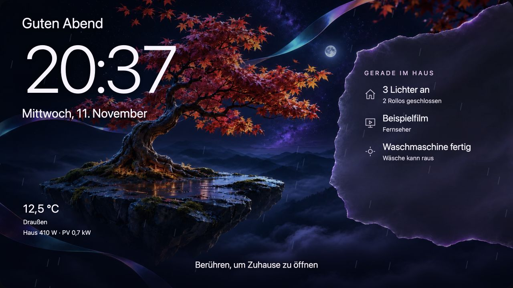

# OLED Bildschirmschoner für Home Assistant

Ein Bildschirmschoner fürs Wandtablet. Er zeigt Uhrzeit, Wetter und den aktuellen Hausstatus vor einer von drei Motivwelten. Baum & Jahreszeiten, Minecraft-Welt und Lichtküste enthalten zusammen 84 Tag-, Nacht-, Saison- und Feiertagsmotive. Eigene Fotos lassen sich im Einstellungsdialog ergänzen.



## Installation über HACS

[](https://my.home-assistant.io/redirect/hacs_repository/?owner=Heinz-Creator&repository=oled-bildschirmschoner&category=plugin)

Der Button funktioniert, sobald das Repository öffentlich ist.

1. Öffne den Button oben und wähle in HACS **Herunterladen**.
2. Lade Home Assistant im Browser neu. Öffne dein Tablet-Dashboard und füge die Karte **OLED Bildschirmschoner** hinzu.
3. Wähle **Bildschirmschoner einstellen** und aktiviere **Auf diesem Display automatisch starten**.

Du kannst das Repository auch über **HACS → Drei-Punkte-Menü → Benutzerdefinierte Repositories** hinzufügen. Die Kategorie lautet **Dashboard**. [HACS-Dokumentation](https://www.hacs.xyz/docs/faq/custom_repositories/)

## Manuelle Installation

1. Lade das GitHub-Archiv herunter und entpacke es.
2. Kopiere **den gesamten Inhalt von `dist/`** in den Ordner `www/oled-bildschirmschoner/` deiner Home-Assistant-Konfiguration. Falls du den Ordner `www` neu anlegst, starte Home Assistant einmal neu.
3. Füge unter **Einstellungen → Dashboards → Ressourcen** die URL `/local/oled-bildschirmschoner/oled-bildschirmschoner.js` als **JavaScript-Modul** hinzu und lade das Dashboard neu. [Ressourcen registrieren](https://contributors.home-assistant.io/frontend/custom-ui/resources/)

## Auf dem Tablet einrichten

Füge die Karte **OLED Bildschirmschoner** auf dem Dashboard hinzu, das auf dem Wandtablet geöffnet bleibt. **Jetzt ansehen** öffnet die Vorschau. Unter **Bildschirmschoner einstellen** wählst du eine Motivwelt und aktivierst **Auf diesem Display automatisch starten**. Die Ruhezeit wird für diesen Browser gespeichert. Tippen oder Escape schließt den Bildschirmschoner. Das Tablet muss das Dashboard geöffnet und das Display eingeschaltet haben.

Licht, Rollos, Wiedergabe und Wetter werden nach Möglichkeit automatisch aus Home Assistant übernommen. Im Karteneditor kannst du die Auswahl einschränken oder weitere Quellen zuordnen. Für Rollos berücksichtigt die automatische Auswahl die Geräteklassen Rollo, Jalousie, Vorhang und Beschattung. Medientitel erscheinen, wenn die Geräteintegration einen Titel oder Sender liefert.

Optional kannst du Hausverbrauch, PV-Leistung, gefühlte Temperatur, Kalender und eine Nachrichten-Entität wählen. Die Nachrichtenquelle ist ein Sensor, der den Titel als Zustand oder im Attribut `title` liefert. Kalenderdaten kommen aus dem gewählten Home-Assistant-Kalender. Eigene Fotos werden im Home Assistant des jeweiligen Nutzers gespeichert. Die Karte zeigt Zustände an und steuert keine Geräte.

## Waschmaschine oder Geschirrspüler fertig

**Gerät liefert einen Status.** Bei Bosch mit Home Connect oder Samsung mit SmartThings kann Home Assistant je nach Modell den Programmstatus lesen. Schau unter **Entwicklerwerkzeuge → Zustände** nach, welchen Zustand dein Gerät nach einem fertigen Programm meldet. Wähle im Karteneditor unter **Gerätemeldungen** diese Entität, trage den beobachteten Zustand und einen Anzeigetext wie „Geschirrspüler fertig“ ein. [Home Connect](https://www.home-assistant.io/integrations/home_connect/) · [SmartThings](https://www.home-assistant.io/integrations/smartthings/)

**Gerät ohne Programmstatus.** Eine für das Gerät geeignete Steckdose mit Leistungsmessung kann den Programmablauf erkennen. Die Automation liest nur den Sensor in **Watt** und ändert einen Status-Helfer.

1. Lege unter **Einstellungen → Geräte & Dienste → Helfer** einen **Auswahl-Helfer** mit den Optionen `Bereit`, `Läuft` und `Fertig` an. Lege pro Gerät einen eigenen Helfer an.
2. [Automation als Blueprint öffnen](https://my.home-assistant.io/redirect/blueprint_import/?blueprint_url=https%3A%2F%2Fgithub.com%2FHeinz-Creator%2Foled-bildschirmschoner%2Fblob%2Fmain%2Fblueprints%2Fgeraet-fertig.yaml). Sobald das Repository öffentlich ist, kannst du den Blueprint importieren und daraus eine Automation erstellen. Wähle den Leistungssensor und den Status-Helfer aus.
3. Im Karteneditor unter **Gerätemeldungen** den Helfer auswählen und als Zustand `Fertig` eintragen. Gib der Anzeige einen Namen wie „Waschmaschine fertig“.

Die Beispielwerte liegen bei über 15 W für zwei Minuten für den Start und unter 3 W für zehn Minuten für das Ende. Passe sie nach einem beobachteten Lauf an dein Gerät an. Die Meldung erscheint erst nach einem erkannten Lauf und wechselt beim nächsten erkannten Start zurück. Ein Neustart unterbricht laufende Wartezeiten. Die Auswertung setzt beim nächsten Schwellenwechsel wieder ein. [Blueprint-Datei](blueprints/geraet-fertig.yaml) · [Home-Assistant-Auslöser](https://www.home-assistant.io/triggers/numeric_state/)

### YAML-Beispiel

Ersetze die Entitätsnamen durch deine eigenen. Alle Einstellungen unterhalb von `type` sind optional.

```yaml
type: custom:oled-bildschirmschoner
lights:
  - light.kueche
  - light.wohnzimmer
covers:
  - cover.rollo_kueche
players:
  - media_player.fernseher
weather: weather.zuhause
house_power: sensor.hausverbrauch
solar_power: sensor.pv_leistung
calendar: calendar.familie
appliances:
  - entity: binary_sensor.waschmaschine_fertig
    state: "on"
    title: Waschmaschine fertig
    detail: Wäsche kann raus
```

## Entwicklung und Veröffentlichung

```sh
npm ci
npm test
npm run build
```

GitHub Actions prüft die HACS-Struktur, sobald das Repository öffentlich ist. Nach einem grünen Lauf ein GitHub-Release erstellen. Für die Aufnahme in die normale HACS-Suche muss der Repo-Eintrag anschließend in `hacs/default` unter `plugin` eingereicht und angenommen werden. [HACS-Aufnahme](https://www.hacs.xyz/docs/publish/include/)

Die mitgelieferten Motivwelten sind eigens für das Projekt erstellte Illustrationen. Minecraft-Welt ist ein inoffizielles Motiv im Blockstil.
